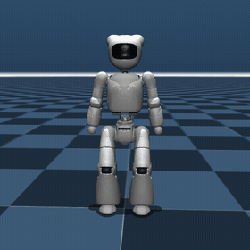
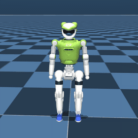
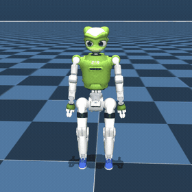
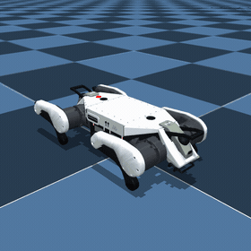
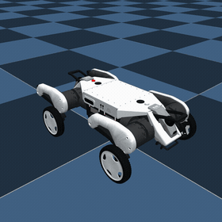
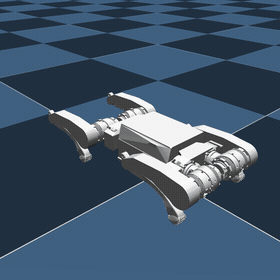
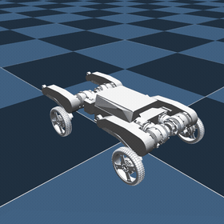
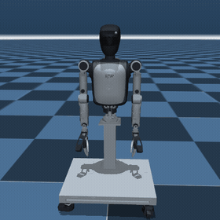
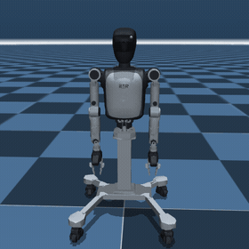

# EIR Robot Description (eir_description)

EmbodiedIntelligentRobot（EIR）开源机器人描述资源库，包含人形、四足、轮足及半身操作平台的 **ROS 2 URDF**、**Pinocchio 简化 URDF** 与 **MuJoCo MJCF** 模型文件及去内构轻量化网格资源，许可证见 [LICENSE](LICENSE)（BSD-3-Clause）。

## 快速开始

在 ROS 2 Humble 环境下构建全部或指定机器人描述包：

```bash
source /opt/ros/humble/setup.bash
colcon build
source install/setup.bash
```

使用 MuJoCo 直接预览模型（在仓库根目录执行）：

```bash
python3 -m mujoco.viewer --mjcf=aiq11_pro_description/urdf/aiq11_pro.xml
```

## 机器人模型列表

<table>
<tr>
  <th width="18%">类型</th>
  <th width="14%">名称</th>
  <th width="48%">描述</th>
  <th width="20%">图片</th>
</tr>
<tr>
  <td>人形/多关节机器人</td>
  <td><b>AIQ01</b></td>
  <td>48自由度爱湫人形机器人模型资源包，搭载3自由度腰部、双臂各5关节、3自由度颈部及仿生耳朵关节，双腿各6关节（含腿部多级连杆机构），包含URDF/MJCF完整模型描述与去内构分色网格资源，搭载IMU传感器，支持完整版与简化版（及`urdf_light/`轻量化版）配置，适配MuJoCo、Isaac Sim仿真平台。</td>
  <td></td>
</tr>
<tr>
  <td>人形/多关节机器人</td>
  <td><b>AIQ11</b></td>
  <td>23自由度爱湫运动版人形机器人模型资源包，专为高动态动作优化。轻量化机身设计，搭载3自由度腰部（含并联机构）、双臂各4关节、双腿各6关节（含脚踝并联机构），头部固定并配备激光雷达与多组深度相机。包含URDF/MJCF模型描述与分色网格资源，适配MuJoCo、Isaac Sim仿真平台。</td>
  <td></td>
</tr>
<tr>
  <td>人形/多关节机器人</td>
  <td><b>AIQ11 Pro</b></td>
  <td>爱湫交互版人形机器人模型资源包，在AIQ11基础上增加3自由度颈部、双臂各3关节、三指灵巧手及头部曲面表情投影。搭载3自由度腰部、双臂各7关节、3自由度颈部、双腿各6关节（含腰/颈/腕/踝多级并联机构）与深度相机。包含URDF/MJCF模型描述与分色网格资源，适配MuJoCo、Isaac Sim仿真平台。</td>
  <td></td>
</tr>
<tr>
  <td>四足机器人</td>
  <td><b>EQR11</b></td>
  <td>12自由度定制型四足巡检机器人模型资源包，搭载多组传感器，支持复杂地形仿真与机器人强化学习训练，适配MuJoCo、Isaac Sim仿真平台。</td>
  <td></td>
</tr>
<tr>
  <td>四足机器人</td>
  <td><b>EQR11W</b></td>
  <td>EQR11同系列轮式四足机器人模型资源包，搭载轮毂电机与多组传感器，采用按实机照片分色的中空外壳，提供URDF/MJCF描述与网格资源，支持MuJoCo仿真及ROS使用。</td>
  <td></td>
</tr>
<tr>
  <td>四足机器人</td>
  <td><b>EQR12</b></td>
  <td>12 自由度点足四足机器人模型资源包，采用去内构的中空显示外壳，保留现有银灰设计配色。提供 URDF/MJCF 描述、17 个显示网格、自研 IP67 电机参数与地形场景，支持 ROS、MuJoCo 仿真及 Isaac Sim 导入。</td>
  <td></td>
</tr>
<tr>
  <td>四足机器人</td>
  <td><b>EQR12W</b></td>
  <td>16 自由度轮式四足机器人模型资源包，包含 12 个腿部关节与 4 个连续轮关节，采用去内构的中空显示外壳，保留现有设计配色。提供 URDF/MJCF 描述与网格资源，支持 MuJoCo 仿真及 Isaac Sim 导入，地形沿用 EQR11W。</td>
  <td></td>
</tr>
<tr>
  <td>人形/半身机器人</td>
  <td><b>EHR21 Half</b></td>
  <td>EHR21 半身人形机器人模型资源包，固定移动底座，搭载 3 自由度腰部（含并联机构）、3 自由度颈部、双臂各 7 关节（含腕部并联机构）及 Gemini336L 深度相机。包含 URDF/MJCF 完整模型描述与网格资源文件，提供完整版（27 自由度）与 Pin 版（19 自由度），适配 MuJoCo、Pinocchio 仿真与控制。</td>
  <td></td>
</tr>
<tr>
  <td>半身/多关节机器人</td>
  <td><b>EHR21G Half</b></td>
  <td>EHR21G 半身人形机器人模型资源包，与 EHR21 Half 同平台，末端执行器由灵巧手更换为 2 自由度平行夹爪（两指齿轮反向联动）。固定移动底座，搭载 3 自由度腰部（含并联机构）、2 自由度颈部、双臂各 7 关节（含腕部并联机构），配备 Gemini305 腕部深度相机×2 与 Gemini336L 头部深度相机×1。包含 URDF/MJCF 完整模型描述与网格资源文件，提供完整版（27 自由度 + 2 指夹爪）与 Pin 版（17 自由度），适配 MuJoCo、Pinocchio 仿真与控制。</td>
  <td></td>
</tr>
</table>


## 机器人模型详解

### AIQ01 (aiq01_description)

**mesh 文件：**

| 目录 | 数量 | 特点 | 用途 |
|------|------|------|------|
| `meshes/`（`*_simplified.STL`） | 36个 | 去内构封闭低面数单色网格 | 仿真与统一外观 |
| `meshes/`（`*_vis_<color>.STL`） | 37个 | 参照 AIQ11 简洁分色的单层外表面视觉网格（素白外壳、黑色高光面罩、银/深灰关节与鞋底），删除旧高精度及冗余凸包网格后全包共 `73` 个网格（`3.20 MiB` / `66,984` 面）；原 5 个网格碰撞体替换为基本体（`0` 个网格碰撞体），完整保留现有手臂、大腿及双脚 6 球触地碰撞 | 彩色仿真可视化 |

传感器：IMU（MJCF site）×1、仿生耳朵关节×4

与简化版的区别：完整版含 3 自由度颈部、仿生耳朵及腿部/腰部并联机构虚拟连杆；简化版 MJCF 为 25 自由度，去除颈部与耳朵。另提供 `urdf_light/` 轻量化版本（结构质量约 35.6 kg）。

**urdf 文件：**

| 文件 | 格式 | 用途说明 |
|------|------|---------|
| `aiq01.urdf` | URDF | ROS 标准完整描述，含全部连杆与并联机构 |
| `aiq01_pin.urdf` | URDF | Pinocchio 参考模型，简化碰撞体配置 |
| `aiq01.xml` | MJCF | MuJoCo 完整版仿真描述，含 ENCOS 电机参数 |
| `aiq01_simplified.xml` | MJCF | MuJoCo 简化版，25 自由度，适用于强化学习训练 |
| `urdf_light/` | 目录 | 轻量化版本 URDF/MJCF，文件结构与 `urdf/` 对应 |

---

### AIQ11 (aiq11_description)

**mesh 文件：**

| 目录 | 数量 | 特点 | 用途 |
|------|------|------|------|
| `meshes/`（`*_simplified.STL`） | 27个 | 去内构封闭低面数单色网格 | 仿真与统一外观 |
| `meshes/`（`*_vis_<color>.STL`） | 45个 | 实机参考分色外表面视觉网格（含半脸墨镜与胸前 EIR 标识），删除旧高精度及冗余网格后全包共 `72` 个网格（`3.74 MB`）；碰撞采用 `21` 个基本体（保留末端 `r=0.03 m` 球体） | 彩色仿真可视化 |

传感器：IMU×1、激光雷达×1、Gemini 336L 深度相机×1、Gemini 336 深度相机×2

机型特点：运动版轻量化设计，头部固定集成于躯干，双臂各 4 关节、双腿各 6 关节；简化版 MJCF 为 23 自由度闭环控制模型。

**urdf 文件：**

| 文件 | 格式 | 用途说明 |
|------|------|---------|
| `aiq11.urdf` | URDF | ROS 标准完整描述，含并联机构虚拟连杆 |
| `aiq11_pin.urdf` | URDF | Pinocchio 参考模型，碰撞体与电机限位校验基准 |
| `aiq11.xml` | MJCF | MuJoCo 完整版仿真描述，含并联机构与 ENCOS 电机参数 |
| `aiq11_simplified.xml` | MJCF | MuJoCo 简化版，23 自由度，适用于强化学习训练 |

---

### AIQ11 Pro (aiq11_pro_description)

**mesh 文件：**

| 目录 | 数量 | 特点 | 用途 |
|------|------|------|------|
| `meshes/`（`*_simplified.STL`） | 42个 | 去内构封闭低面数单色网格 | 仿真与统一外观 |
| `meshes/`（`*_vis_*`） | 75个STL + 1组OBJ/MTL + 15张PNG | 实机参考分色外表面视觉网格与头部曲面表情投影贴图（含前脸曲面表情罩 `neck_l3_vis_face.{obj,mtl,png}`、`meshes/faces/` 下 `14` 张可动态切换静态预设表情贴图、绿色波浪眉弓/大小耳朵与胸前 EIR 标识）；全包共 `136` 个资源文件（含 `2` 个凸包碰撞 STL，合计 `9.27 MiB`） | 彩色仿真可视化与动态表情切换 |

传感器：IMU×1、Gemini 336L 深度相机×1、Gemini 336 深度相机×2

与 AIQ11 的区别：新增 3 自由度颈部与双臂腕部（各 7 关节），完整版 URDF/MJCF 含腰部、颈部及脚踝并联机构的虚拟连杆建模；简化版 MJCF 为 32 自由度闭环控制模型。

三指夹爪编号在左右手上使用相同的机器人本体相对位置定义：`fg1` 为单自由度主指，`fg2` 为靠近身体的双自由度副指，`fg3` 为远离身体的双自由度副指。编号不随观察视角改变。左手对应 `l_fg1/l_fg2/l_fg3`，右手对应 `r_fg1/r_fg2/r_fg3`。

**urdf 文件：**

| 文件 | 格式 | 用途说明 |
|------|------|---------|
| `aiq11_pro.urdf` | URDF | ROS 标准完整描述，含并联机构虚拟连杆 |
| `aiq11_pro_pin.urdf` | URDF | Pinocchio 参考模型，碰撞体与电机限位校验基准 |
| `aiq11_pro.xml` | MJCF | MuJoCo 完整版仿真描述，含并联机构与 ENCOS 电机参数 |
| `aiq11_pro_simplified.xml` | MJCF | MuJoCo 简化版，32 自由度，适用于强化学习训练 |

---

### EQR11 (eqr11_description)

**mesh 文件：**

| 目录 | 数量 | 特点 | 用途 |
|------|------|------|------|
| `meshes/`（`*_vis_*`，STL） | 34个 | 中空分色外壳，保留电机端盖、凸耳及护罩轮廓 | 仿真可视化 |
| `meshes/`（`*_collision_*.STL`） | 4个 | 机身前后端补块，配合原有基本体，共41个碰撞体 | 碰撞检测 |

全包共38个STL、4.07 MiB。12自由度四足巡检机器人，支持平地、坡道及阶梯场景。

传感器：激光雷达×2、Gemini 336 双目相机×2、Gemini 335LE×2

**urdf 文件：**

| 文件 | 格式 | 用途说明 |
|------|------|---------|
| `eqr11.urdf` | URDF | ROS标准描述，24个关节、12个驱动自由度 |
| `eqr11.xml` | MJCF | MuJoCo仿真描述，含EC-A8116/EC-A10020电机参数 |

---

### EQR11W 轮式四足 (eqr11w_description)

**mesh 文件：**

| 目录 | 数量 | 特点 | 用途 |
|------|------|------|------|
| `meshes/`（`*_vis_*`、`*_simplified`，STL） | 46个 | 实机配色的中空外壳，保留电机端盖、凸耳、轮胎纹路及轮盖开口 | 仿真可视化 |
| `meshes/`（`*_collision_*.STL`） | 12个 | 8个原有轮端网格及4个机身前后端补块，配合基本体共45个碰撞体 | 碰撞检测 |

全包共58个STL、18.84 MiB。浅灰护罩与轮盖、深色电机及黑色底盘，红色急停位于机身后端。

传感器：激光雷达×2、Gemini 336 双目相机×2、Gemini 335LE×2

与EQR11的区别：增加4个连续轮关节，共16个驱动自由度；控制版额外保留四个`*_leg_lee`固定坐标系别名。

**urdf 文件：**

| 文件 | 格式 | 用途说明 |
|------|------|---------|
| `eqr11w.urdf` | URDF | ROS标准描述，38个关节、16个驱动自由度 |
| `eqr11w_control.urdf` | URDF | 控制用描述，42个关节，含四个足端坐标系别名 |
| `eqr11w.xml` | MJCF | MuJoCo仿真描述，适配轮式驱动物理参数 |
| `eqr11w_sensor.xml` | MJCF | 含传感器配置的仿真模型 |
| `eqr11w_suspended.xml` | MJCF | 悬挂调试场景 |
| `eqr11w_policy_cameras.xml` | MJCF片段 | 三套场景共用的四路策略相机位姿与内参 |

---

### EQR12 点足四足 (eqr12_description)

**mesh 文件：**

| 目录 | 数量 | 特点 | 用途 |
|------|------|------|------|
| `meshes/`（`*_simplified.STL`） | 17个 | 去内构的封闭单层外表面，共 298,958 面，保留机身、腿部轮廓及足底胎块/沟槽 | URDF/MJCF 仿真可视化 |

结构：17 个连杆、16 个 URDF 关节（12 个腿部转动关节、4 个固定足端关节），12 个驱动自由度（不含浮动基座），总质量 **42.64976029 kg**。

传感器：IMU（MJCF site）×1、关节位置/速度/执行器力传感器及基座状态传感器；共 42 个传感器、55 个标量输出。

去除机身、电机、腿部和足端内部装配结构，只保留中空显示外壳；中空不定义制造壁厚。删除 17 个含内构的原始 CAD 网格及 17 个未使用的整连杆凸包，恢复电机外形后，当前显示网格共 298,958 面，17 个 STL、14.26 MiB；原始资源为 51 个、95.80 MiB（按 Git LFS 完整资产统计）。保留现有银灰设计配色，未做实机分色校准。

2026-11-25恢复四腿髋部、大腿及机身侧电机的端盖台阶、外周凸耳、环槽与连接壳轮廓，更新9个STL。保留单层中空外表面，封闭内部孔腔；细小孔槽仍简化，不作为制造模型。

复核修正足底纹路被凸包抹平及小腿外壳起伏失真：保留原 CAD 橡胶足底的胎块/沟槽，封闭安装结构；小腿保留原 CAD 外壳曲面并封闭内部腔体开口。小腿 13 个截面的外边界最大偏差约 0.31 mm，左右镜像一致。此前仅检查整机轮廓不足以发现局部问题，本次增加分部件六向对照、截面和足底检查。

实际碰撞采用 37 个盒体、12 个圆柱和 4 个球体，共 53 个基本体，无碰撞网格。源 URDF/MJCF 保持原样，质量、惯量、关节、碰撞、驱动、传感器及 home 关键帧不变。地形包含平地、坡道、平台和阶梯。README 旋转图由当前模型渲染为 CAD 零位趴姿，480×480、150 帧，仅调整预览相机和离地高度。

电机采用 HY-N8513-X32-IP67（A/H/K），减速比 32，电机侧输入 ±5.625 N·m、关节侧峰值 ±180 N·m，armature 为 0.11173888 kg·m²。MJCF 使用 0.005 s 步长、implicitfast/Newton；速度上限字段为 12.5663706143592 rad/s，仅作元数据，限速需控制器执行。

**urdf 文件：**

| 文件 | 格式 | 用途说明 |
|------|------|---------|
| `eqr12.urdf` | URDF | ROS 标准描述，显式连杆惯性与基本体碰撞 |
| `eqr12.xml` | MJCF | MuJoCo 仿真描述，含 12 路执行器、传感器与地形 |

17 个显示网格通过闭合性与内构检查，ROS 解析及资源安装通过；MuJoCo 零位/home 各 1,000 步（各 5 s）对照状态一致。Isaac Sim 5.1.0 已完成 17 个网格/材质、12 个自由度和质量核对、四视角 RTX 渲染及 1,000 步被动仿真；不包含闭环控制或实机验证。

构建、验证范围见[包说明](eqr12_description/README.md)，惯量约定、电机及控制接口见[模型说明](eqr12_description/urdf/eqr12_model_notes.md)。

---

### EQR12W 轮式四足 (eqr12w_description)

**mesh 文件：**

| 目录 | 数量 | 特点 | 用途 |
|------|------|------|------|
| `meshes/`（`*_simplified.STL`） | 21个 | 去内构的封闭单层外表面，共 398,560 面，保留机身、腿部轮廓及完整轮胎/轮辐 | URDF/MJCF 仿真可视化 |
| `meshes/`（`base_link_*_support.STL`） | 4个 | 机身底部四个支撑块的局部凸包 | `base_link` 局部碰撞 |

结构：21 个连杆、20 个 URDF 关节（12 个腿部转动关节、4 个连续轮关节、4 个固定轮毂座关节），16 个驱动自由度（不含浮动基座），总质量 **49.71878463 kg**。

传感器：IMU（MJCF site）×1、关节状态传感器。

共 25 个 STL 平铺于 `meshes/`，当前总大小19.01 MiB（原始资源122.22 MiB）；删除 21 个含内构的原始 CAD 网格及 21 个未引用的整连杆凸包。恢复电机外形后，当前显示网格共398,560面，中空指只保留显示外表面，不保留内部零件或内层壁面，不定义制造壁厚。尚无实机照片，本次保留现有设计配色，未做实机分色校准。

2026-11-25电机端部修正：按CAD截面修复四个髋部和四个轮毂座的局部扩边；髋部按原CAD坐标变换保持四腿对应，保留轮胎、轮辐、设计配色与物理参数，更新8个STL和趴姿动图。

2026-11-25恢复四腿髋部、大腿、机身侧电机及轮毂座的端盖台阶、外周凸耳和环槽，更新13个STL。保留单层中空外表面，封闭内部孔腔；细小孔槽仍简化，不作为制造模型。

小腿已修正此前等厚拉伸造成的外形偏厚，使用与原 CAD 一致的变厚度外壳曲面；13 个截面的外边界最大偏差约 0.31 mm，左右镜像一致。

四轮已修正此前减面造成的轮辐丢失、内圈折面及左右不对称：保留原 CAD 轮毂、四根轮辐和开孔，轮胎单独减面；左右外形镜像一致。单轮 21,666 面，轮轴正视轮廓与原 CAD 的交并比为 99.94%，轮毂/轮辐区域为 99.995%；4,096 个方向的胎面外包络相对半径 102.5 mm 圆的最大内偏差为 0.074 mm。

URDF/MJCF 描述文件和 4 个支撑块碰撞网格保持原样，质量、惯量、关节、驱动、传感器及 home 关键帧不变。README 动图由当前模型重新渲染为 CAD 零位趴姿，150 帧、480×480；仅在预览中调整离地高度与相机。实际碰撞模型由 33 个盒体、20 个圆柱和 4 个局部凸包组成，共 57 个碰撞体；四个机身底部支撑块同属 `base_link`。地形沿用 EQR11W 的平地、坡道、平台和阶梯。

**urdf 文件：**

| 文件 | 格式 | 用途说明 |
|------|------|---------|
| `eqr12w.urdf` | URDF | ROS 标准描述，保留固定轮毂座的独立惯性及组合碰撞体 |
| `eqr12w.xml` | MJCF | MuJoCo 仿真描述，含 16 路执行器、传感器与地形 |

21 个显示网格通过闭合性与内构检查，ROS 解析及资源安装通过；MuJoCo 零位/home 各 1,000 步对照状态一致。Isaac Sim 5.1.0 已完成 21 个网格/材质、16 个自由度和质量核对、四视角 RTX 渲染及 1,000 步被动仿真；不包含闭环控制或实机验证。

构建与加载方法见[包说明](eqr12w_description/README.md)，电机参数、惯量约定及控制接口见[模型说明](eqr12w_description/urdf/eqr12w_xml说明.md)。

---

### EHR21 Half (ehr21_half_description)

**mesh 文件：**

| 目录 | 数量 | 特点 | 用途 |
|------|------|------|------|
| `meshes/`（`*_simplified.STL`） | 19个 | 去内构封闭低面数单色网格 | 仿真与共用可视化 |
| `meshes/`（`*_vis_<color>.STL`） | 31个 | 实机参考分色外表面视觉网格（含黑色/墨镜面罩头壳、钛银前胸甲+胸前红色 `EIR TECHNOLOGY` 三维标识与灵巧手分色） | 彩色仿真可视化 |
| `meshes/`（`left_/right_*.STL`） | 24个 | 因时灵巧手（Inspire Hand）轻量化指节网格 | 灵巧手可视化 |

说明：已删除旧高精度原始 STL 与 `*_convex.STL`，全包仅保留上述 `74` 个活动网格（`2.47 MB`）；`torso_l3_convex.STL` 碰撞已替换为盒体基本体，三份模型均无网格碰撞体（`ehr21_half.xml` `41` 个、`ehr21_half.urdf` `42` 个、`ehr21_half_pin.urdf` `41` 个基本体）。

传感器：IMU（MJCF site）×1、Gemini336L 深度相机×1

与完整版的区别：完整版 URDF/MJCF 保留腕部与腰部并联机构辅助关节（`l/r_arm_51/52`、`torso_31~34`）；Pin 版 URDF 合并主运动链为 19 自由度树结构，去除辅助 link。

**urdf 文件：**

| 文件 | 格式 | 用途说明 |
|------|------|---------|
| `ehr21_half.urdf` | URDF | ROS 标准完整描述，含并联机构虚拟连杆，42 个基本体碰撞 |
| `ehr21_half_pin.urdf` | URDF | Pinocchio 参考模型，19 自由度，保留 41 个基本体碰撞 |
| `ehr21_half.xml` | MJCF | MuJoCo 完整版仿真描述，含并联约束、41 个基本体碰撞与 ENCOS 电机参数 |

---

### EHR21G Half (ehr21g_half_description)

**mesh 文件：**

| 目录 | 数量 | 特点 | 用途 |
|------|------|------|------|
| `meshes/`（`*_simplified.STL`） | 23个 | 去内构封闭低面数单色网格 | 仿真与可视化 |
| `meshes/`（`*_vis_<color>.STL`） | 27个 | 分色外表面视觉网格（供 URDF 加载） | 彩色可视化 |
| `meshes/ehr21/` | 38个 | `ehr21g_half.xml` 复用的 EHR21 公共低面数分色网格 | MuJoCo 彩色仿真可视化 |

说明：本仓库仅收录轻量化可视网格（全包共 `88` 个 STL，合计约 `3.68 MB`），碰撞全部采用原生基本体（MJCF `35` 个、URDF `33` 个基本体，`0` 个网格碰撞体）。

传感器：Gemini305 深度相机×2（`gemini305_l1` 挂 `r_arm_l7`、`gemini305_l2` 挂 `l_arm_l7`）、Gemini336L 深度相机×1（`gemini336l_l1` 挂 `neck_l2`）

与 EHR21 Half 的关系：**同一半身平台，末端执行器由灵巧手更换为 2 自由度平行夹爪**（`l/r_fg_l0` 主动指、`l/r_fg_l1` 从动指，`<mimic multiplier="-1">` 齿轮反向联动）。躯干、颈部、双臂结构与 EHR21 Half 一致，完整版保留腕部与腰部并联机构辅助关节（`l/r_arm_51/52`、`torso_31~34`）。本体 27 自由度 + 4 个夹爪关节（其中 2 个为 mimic 从动），完整版总质量 **53.03483401 kg**，Pinocchio 版总质量 **52.92505625 kg**。详见[包说明](ehr21g_half_description/README.md)。

**urdf 文件：**

| 文件 | 格式 | 用途说明 |
|------|------|---------|
| `ehr21g_half.urdf` | URDF | ROS 标准完整描述，含并联机构虚拟连杆与 33 个基本体碰撞 |
| `ehr21g_half_pin.urdf` | URDF | Pinocchio 参考模型，17 自由度，去除并联辅助分支 |
| `ehr21g_half.xml` | MJCF | MuJoCo 控制仿真版，含 4 条腰腕 `<connect>`、2 条夹爪联动约束与 21 路执行器 |

> MuJoCo 请使用 `ehr21g_half.xml`（通过 `<equality>` 约束实现两指反向联动与腰腕闭链）；MuJoCo 的 URDF 解析器会忽略 URDF 的 `<mimic>` 标签。

---

### Gemini 相机坐标系

本节按相机型号说明坐标系的用途及内部位置关系，供不同机器人模型复用。相机本体通过固定连接安装在机器人连杆上，具体安装位置和方向由各模型文件定义。

下表中的 `<相机名>` 表示模型中相机本体的名称，例如 `gemini_335le_l1`、`gemini_336_l1`；名称后缀可按安装位置或编号设置。

| 坐标系 / 标记 | 作用 | 父坐标系 |
|---|---|---|
| `<相机名>` | 相机本体的安装参考系，定义相机相对于安装连杆的位置和方向 | 实际安装连杆，如 `base_link` 或头部连杆 |
| `<相机名>_rgb_camera_link` | RGB 成像参考系，结合相机内参用于图像投影、彩色图像与深度数据配准 | 相机本体 |
| `<相机名>_depth_camera_link` | 深度成像参考系，用于表达深度图反投影得到的三维点，并将点云变换到机身或世界坐标系 | 相机本体 |
| `<相机名>_laser_emitter_link` | 主动深度测量所用激光发射器的位置与方向参考，用于安装关系表达和投射器建模 | 相机本体 |
| `<相机名>_site` | MJCF 中可选的本体原点标记，用于可视化及读取相机本体位姿，与相机本体坐标系重合 | 相机本体 |

**相机内部的位置关系：** 下表列出 Gemini 335LE 和 Gemini 336 在模型中采用的各子坐标系原点位置，表示为相机本体坐标系中的 `(X, Y, Z)`，单位为 mm；URDF 的 `xyz` 和 MJCF 的 `pos` 使用 m。同一型号采用相同的本体坐标系定义时，可复用这些内部偏移。

| 相机型号 | RGB 坐标系 | 深度坐标系 | 激光发射器坐标系 |
|---|---|---|---|
| Gemini 335LE | `(23.75, 0, 0)` | `(0, 0, 0)` | `(47.5, 0, 0)` |
| Gemini 336 | `(0, 0, 0)` | `(-14, 0, 0)` | `(11, 0, 0)` |

上表采用的子坐标系相对本体的旋转均为零，因此它们的坐标轴方向一致。335LE 的本体原点与深度坐标系重合，RGB 原点位于本体 `+X` 方向 23.75 mm 处；336 的本体原点与 RGB 坐标系重合，深度原点位于 `-X` 方向 14 mm 处。以上偏移均沿相机本体坐标轴，转换到机器人基座或世界坐标系时，还需沿连杆链应用相应的旋转和平移。

**URDF 与 MuJoCo 的对应关系：** URDF 使用空 `link` 和 `fixed joint` 定义 RGB、深度及激光发射器坐标系；MJCF 在对应相机 `body` 下使用同名 `site` 表达。两种格式应保持子坐标系名称、父坐标系、局部位置和方向一致，相机本体的安装变换也应对应。MuJoCo 中可通过 `data.site_xpos` 和 `data.site_xmat` 读取这些标记在世界坐标系下的位置和方向。

**坐标标记与图像生成：** `site` 用于表达位姿，本身不生成 RGB 图像、深度图或激光投射效果。需要生成仿真图像时，应另外配置 `<camera>`，设置成像位置、朝向和视场角，并处理 MuJoCo 相机沿局部 `-Z` 观察、`+Y` 向上的轴约定。

对接真实相机驱动时，需要核对驱动的光学坐标轴约定及标定外参，并按需定义 `*_optical_frame` 及其变换；上述固定变换表示模型中的安装关系。

---

### Gemini 深度相机视场角

深度相机在 2 m 距离下，不同图像宽高比对应的视场角如下：

| 图像宽高比 | Gemini 335/336 | Gemini 335L/336L |
|---|---|---|
| 16:10 | H 90°，V 65° | H 90°，V 65° |
| 16:9 | H 90°，V 60° | H 90°，V 60° |
| 4:3 | H 81°，V 65° | H 81°，V 65° |
| Other（848×100） | H 90°，V 14° | H 90°，V 14° |

---

## 文件结构说明

所有机器人描述资源包遵循标准 ROS 2（`ament_cmake`）与仿真平台规范：

- **`urdf/`**：包含 ROS 标准 `.urdf`、Pinocchio 树形简化 `*_pin.urdf` 及 MuJoCo 仿真场景 `.xml`（MJCF）。
- **`meshes/`**：去内构轻量化网格资源目录，不含内部装配零件：
  - `*_vis_*`：按实机或设计材质拆分的封闭单层外表面视觉网格（STL / OBJ + PNG 贴图）；
  - `*_simplified.STL`：低面数单色简化网格；
  - `*_convex.STL` / `*_collision*.STL` / `*_support.STL`：局部凸包碰撞网格（多数机型已采用原生基本体碰撞）。
- **`package.xml` & `CMakeLists.txt`**：ROS 2 包清单与安装配置。

### Isaac Lab 转换 USD 示例

```bash
cd IsaacLab
./isaaclab.sh -p scripts/tools/convert_urdf.py \
  /path/to/aiq11_description/urdf/aiq11_pin.urdf \
  /path/to/output/aiq11.usd \
  --merge-joints \
  --joint-stiffness 0.0 \
  --joint-damping 0.0 \
  --joint-target-type none
```
