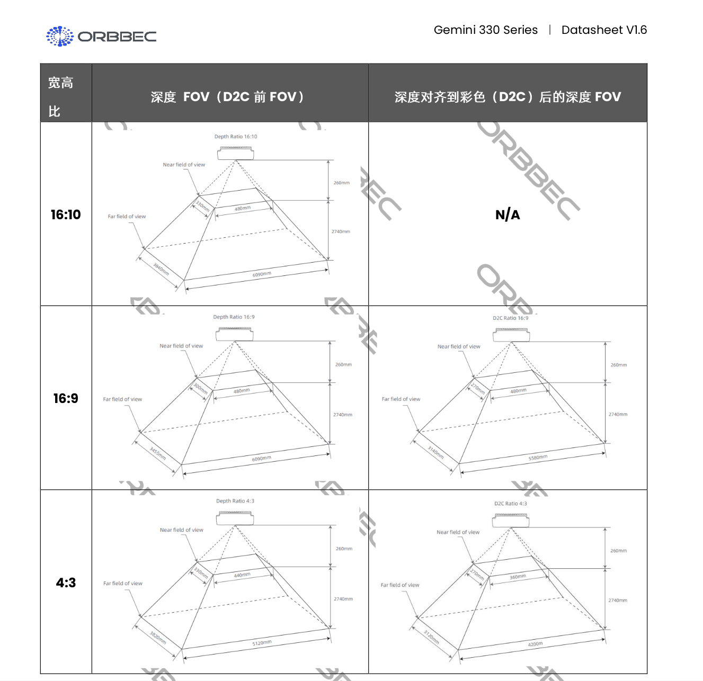

# AIQ11 传感器坐标系

## 腿部参数

腿部 armature、frictionloss、damping 来自双腿台架重测，须配合驱动参数使用；`damping` 是被动阻尼 B，
不是训练 Kd。各关节参数定义在 `urdf/aiq11.xml` 与 `urdf/aiq11_simplified.xml` 中。

## 质量与惯量（2026-11-05）

全部连杆的质量、质心和惯量基于运动版 CAD 装配体质量属性标定，整机总质量 **38.137 kg**。

- 每块数据的“坐标系”即同名 link 坐标系（`base_frame` 对应 `base_link`；`imu_frame`、`lidar_frame`、`gemini_336l_frame`、`gemini_336_f_frame`、`gemini_336_b_frame` 分别对应 `imu_l0`、`lidar_ariy_l0`、`gemini_336l_l0`、`gemini_336_lf`、`gemini_336_lb`）。质心直接写入；惯量取“由重心决定，并且对齐输出的坐标系”的 Lxx…Lzz。SolidWorks 正张量记数法列出的是惯性积 ∫xy dm，写入惯量张量时 ixy、ixz、iyz 取其相反数（已用其输出的主轴方向核对）。
- 原文件中左手一块误用了 `r_hand_l0` 坐标系输出（质量与右手相同），左手按右手关于 y 镜像。
- URDF：手、脚、传感器保留为独立 link，传感器 inertial 由注释改为启用（雷达为新型号 0.231 kg，后置 336 相机补上质量）。MJCF：手并入 `*_arm_l4`，脚并入 `*_leg_l6`，IMU 和前后 336 相机并入 `base_link`，雷达和 336L 并入 `torso_l3`，按 URDF 固定关节位姿合成，写成主惯量加四元数。
- `aiq11_pin.urdf`、`aiq11_simplified.xml` 与主模型同名连杆取相同数值，仍不含腰、踝闭链连杆。
- 与旧模型相比：躯干 +1.135 kg、每条腿 +0.875 kg、每条手臂 −0.062 kg；多数连杆惯量增大 1.3–6 倍（躯干最大）；READY 姿态整机质心下移约 15 mm。策略多按旧模型训练，切换后需重新验证。

## 视觉网格、配色与碰撞体优化（2026-11-20）

- 完全剔除电机、轴承、PCB、散热片、螺钉与雷达内部光学件等全部不可见内构，并对双层带孔 `torso_l3` 重构光滑封闭单层外包络（相机槽由单层外壳切分凹槽，修剪饰件内伸凸耳）；移除旧高精度 `<link>.STL`、未使用 `*_convex.STL`、`head_simplified.STL` 与多色连杆冗余 `*_simplified.STL`，`meshes/` 由 `181` 个减至 `72` 个活动文件（`3828.8 KB` / `3.74 MB`，含 `27` 个 `*_simplified.STL` 与 `45` 个 `*_vis_<color>.STL`）。`aiq11.xml` 与 `aiq11_simplified.xml` 分别使用 `72` 网格（`78,293` 面，较原 `456,341` 面 `-82.8%`）和 `60` 网格（`73,773` 面，较原 `444,692` 面 `-83.4%`）。
- 按实机照片与参考视频应用 `aiq_*` 材质组：在前胸相机槽上方加入贴合曲面的白色 `EIR TECHNOLOGY` 三维浮雕标识，保留镂空白色头环、加装弧形半脸墨镜（`torso_l3_vis_visor.STL`、`aiq_visor`）、绿色眉弓/大小耳朵与深色颈圈，同步 Pro 腿部外罩与蓝色鞋面。
- 全部模型碰撞体由网格/多球簇替换为极简基本体（MJCF `21` 个 + `15` 组 `<contact><exclude>`，URDF `21` 个，`0` 个网格碰撞体），完整保留双臂末端 `r = 0.03 m` 球体碰撞体（`l/r_arm_l4` 与 `l/r_hand_l0`），保持 `group="1"/"2"`、触地高度（MJCF `leg_l6 z=-0.044 m`，URDF `foot_l0 z=-0.017 m`）及全套质量惯量、关节和物理/传感器参数不变。

## 传感器坐标系约定

所有传感器坐标系均使用其所属 Gemini link 的局部坐标系，并保持与该
link 相同的朝向。URDF 中使用 `*_link`，MuJoCo XML 中使用同名的
`site`。

## 坐标系用途

- `*_rgb_camera_link`：RGB 相机的坐标原点。
- `*_depth_camera_link`：深度相机的坐标原点。
- `*_laser_emitter_link`：激光发射点。在仿真中构建深度扫描相机时，
  使用该坐标系作为射线发射原点。

## 坐标偏移

`gemini_336_lf` 和 `gemini_336_lb` 的 link 原点是 RGB 相机原点：

| 坐标系 | 局部 XYZ (m) |
| --- | --- |
| RGB 相机 | `0 0 0` |
| 深度相机 | `-0.014 0 0` |
| 激光发射点 | `0.011 0 0` |

`gemini_336l_l0` 的 link 原点是深度相机原点：

| 坐标系 | 局部 XYZ (m) |
| --- | --- |
| 深度相机 | `0 0 0` |
| RGB 相机 | `0.02375 0 0` |
| 激光发射点 | `0.0475 0 0` |

## 深度扫描偏置

仿真中的深度扫描从激光发射点出发。将扫描得到的深度点换算到深度相机
原点时，需要沿深度测距的正方向添加一个正值偏置。偏置量应与深度扫描
输出使用相同的距离单位：

| 传感器型号 | 正向偏置 |
| --- | --- |
| Gemini 336 | `0.025` |
| Gemini 336L | `0.0475` |

## 深度图有效范围

原始深度图中的无效像素通常为 `0`。仿真输出深度图时，对每个测距值应用
以下规则，距离单位为 mm：

- 距离小于 `260`：置为 `0`。
- 距离大于 `3000`（`260 + 2740`）：置为 `0`。
- 距离位于 `[260, 3000]`：保留原始深度值。
